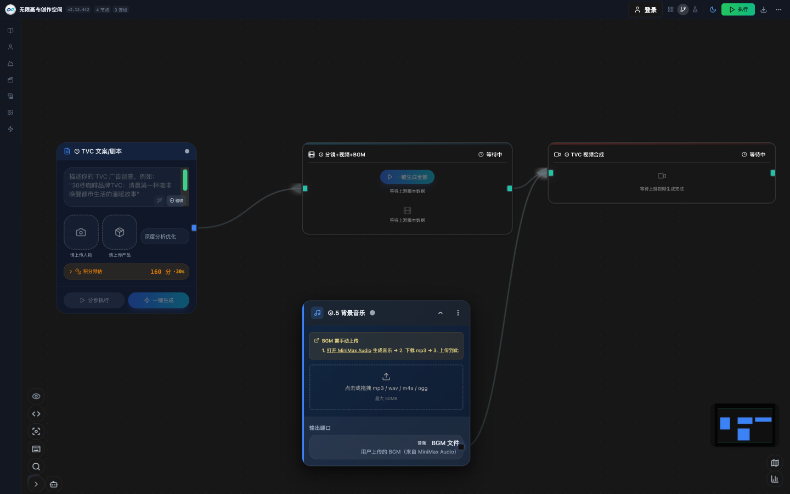
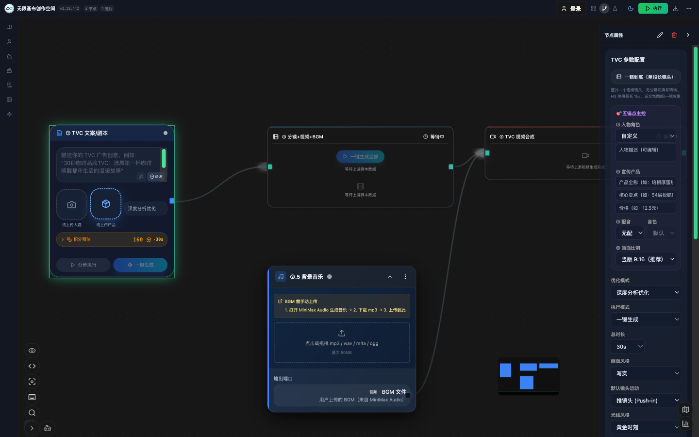
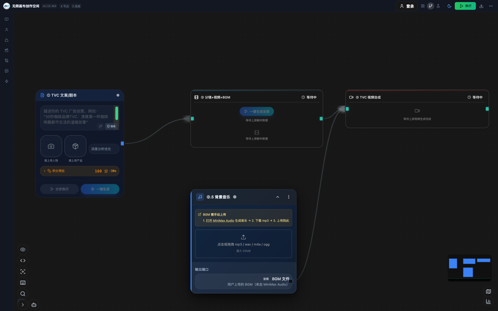
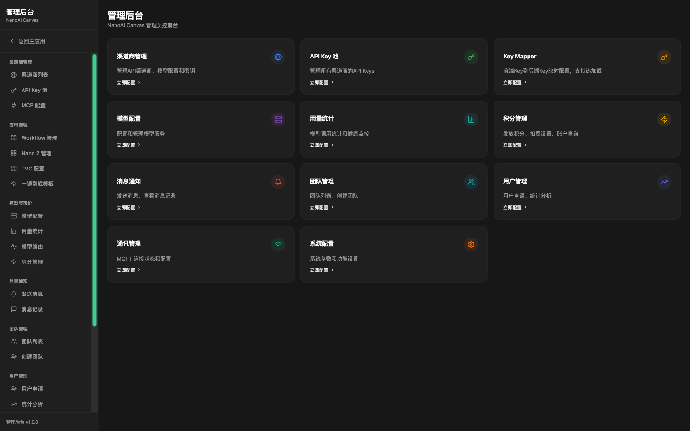
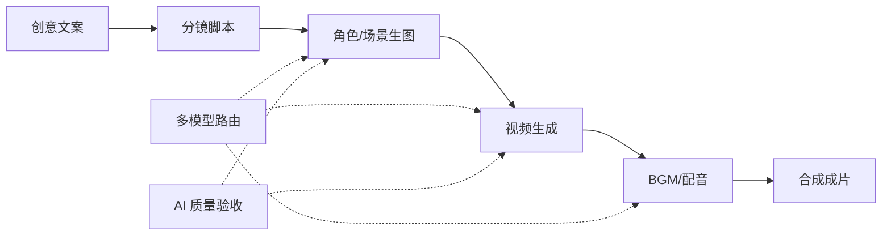

# NanoAi无限画布 · AI 驱动的无限画布创作平台

> 从创意到成片，一站式 AI 内容生产工作流

## 一、产品定位

NanoAi无限画布 是一个基于无限画布的 AI 内容生产平台。以可视化节点工作流为核心，打通「创意文案 → 分镜设计 → 图像生成 → 视频生成 → 配乐合成 → 成片输出」全链路，让创作者在一个画布内完成过去需要多款工具反复衔接的全部工作。

与 ComfyUI 等节点式创作工具相比，NanoAi无限画布 的核心差异在于：**端到端一站式**。ComfyUI 擅长单点图像生成的精细化编排，但文案、分镜、视频、配乐、成片仍需借助外部工具手工衔接；NanoAi无限画布 将完整内容生产管线内化为平台能力，节点之间数据自动流转，一键即可从一句话创意直达成片。

## 二、核心价值

- **全链路闭环**：文案、分镜、生图、视频、BGM、合成六大环节全部内置，无需在多个工具间导出导入。
- **全模型栈智能路由**：DeepSeek-V4-Pro 剧本创作模型、先进的生图与视频生成模型、MiniMax 音色设计与 TTS 语音合成模型，按任务特性自动路由，避免单一供应商锁定。
- **可视化编排**：基于 React Flow 的无限画布，拖拽节点、连接数据流，工作流所见即所得。
- **模板化生产**：内置数十种工作流模板（TVC 广告、故事板、角色设计、场景设计等），开箱即用。
- **企业级管理**：积分计价、团队协作、API Key 池、用量审计等运营能力完备。

## 三、功能矩阵

| 能力域 | 功能 | 说明 |
|--------|------|------|
| 创意输入 | 文案/剧本生成 | 结构化剧本输出，含分镜脚本与配音时间轴 |
| 视觉设计 | 角色设计 / 场景设计 | AI 角色三视图、场景概念图，支持参考图一致性控制 |
| 视频生产 | 图生视频 / 文生视频 | 多模型视频生成，支持首尾帧锚定、口型同步 |
| 音频生产 | BGM 生成 / 配音 | 国风到影视级配乐；MiniMax 音色设计与 TTS 模型，多音色自然语音 |
| 后期合成 | 视频合成引擎 | 转场、字幕、混音、多规格输出（1080p/4K） |
| 质量控制 | AI 视觉验收 | 生成结果自动一致性评分，不达标自动降级重试 |
| 协作运营 | 团队 / 积分 / 资产库 | 团队积分优先、资产版本管理、全链路审计 |

## 四、产品界面



*无限画布 · TVC 全链路节点编排*



*节点属性面板 · 五锚点主控 / 一镜到底 / 画面比例 / 优化模式*



*工作流节点 · BGM 接入与音频输出端口*



*管理后台 · 渠道商 / API Key 池 / 模型配置 / 积分与团队运营*

## 五、与 ComfyUI 的对比

| 维度 | NanoAi无限画布 | ComfyUI 类节点工具 |
|------|--------------|-------------------|
| 生产管线 | 文案到成片端到端闭环 | 聚焦单点图像生成编排 |
| 算力形态 | NanoAi Node 分布式算力池，云端弹性扩缩 | 本地单机算力，受限于本机硬件 |
| 任务调度 | 错峰自动调度（白天下单/夜间执行/早上审稿） | 手动触发，无队列调度 |
| 视频能力 | 内置图生视频/文生视频/口型同步 | 需外挂第三方视频工具 |
| 音频能力 | 内置 BGM 生成与配音 TTS | 不支持，需外部工具 |
| 模型接入 | 多服务商智能路由，云端托管 | 依赖本地模型与手动装插件 |
| 使用门槛 | 模板化开箱即用，业务人员可上手 | 面向算法工程师，门槛高 |
| 协作运营 | 团队/积分/资产库/审计完备 | 单机为主，协作能力弱 |
| 部署形态 | 云端服务，浏览器即用 | 本地部署，依赖硬件配置 |

## 六、技术架构

平台采用前后端分离架构：前端为 React 19 + React Flow 无限画布；后端为 FastAPI + PostgreSQL + Redis，承载工作流执行引擎、任务队列与多 AI 服务路由；另设 Agent 子系统，以多角色协作方式支撑复杂创作任务。



```
创作者（白天下单）
   ↓ 提交任务
NanoAi 无限画布平台（任务编排 · 算力分配 · 队列调度 · 质量验收）
   ↓ 算力分配
NanoAi Node 算力池 —— Node① 生图算力 | Node② 视频算力 | Node N… 弹性扩缩
   ↓ 夜间排队并行执行 · 产出回传
创作者（早上审稿验收）

错峰调度时序：白天 下单+审稿 → 夜间 Node 池满负荷执行 → 早上 产出验收交付
```

- **NanoAi Node 分布式执行网络**：带算力的任务执行节点组成分布式算力池，平台自动完成算力分配与任务调度，多任务并行不排队。
- **Go 语言底层节点**：Node 以 Go 编写——高并发原生支持（单节点多任务并行）、编译为单一二进制（零依赖一条命令部署）、跨 Windows/Linux/macOS/ARM 全平台、无虚拟机运行时开销资源占用极低，任何闲置电脑可秒变算力节点。
- **错峰调度工作流**：「白天计划下单，夜间排队执行，早上审稿验收」——任务自动避开制作团队高峰期，白天聚焦质量审查与创意打磨，夜间算力满负荷运转。
- **工作流引擎**：异步多步编排，断点续传，实时进度推送。
- **Agent 子系统**：制作人、编剧、导演、美术、配音、剪辑等多角色 AI 协作，具备记忆与自优化能力。
- **质量闸**：生成结果自动视觉验收与一致性评分，低分自动重试，降低人工返工。

## 七、适用场景

- **广告营销**：TVC/短视频广告从创意到成片的快速量产。
- **内容创作**：知识解说、短剧、数字人口播等内容流水线。
- **数字人生产**：人物形象设计、一致性控制、口播视频生成的完整管线。
- **文创设计**：角色设定、场景概念图的批量探索与筛选。

## 八、总结

NanoAi无限画布 把「AI 内容生产」从多个离散工具的手工拼接，升级为一个画布内的自动化流水线。对于需要持续产出视频内容的团队，它意味着更短的交付周期、更低的多工具协作成本，以及可运营、可审计的生产过程。
